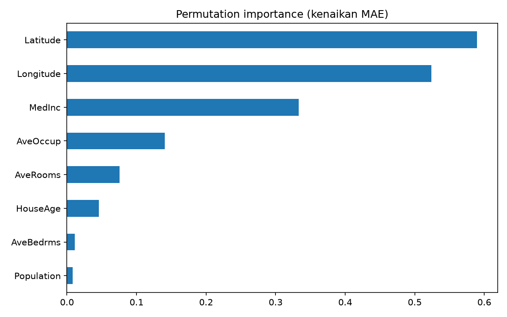

# California Housing Regression

Prediksi median harga rumah per blok wilayah di California menggunakan
regresi dengan scikit-learn. Proyek latihan untuk alur kerja ML end to end:
EDA, baseline, perbandingan model, tuning, dan evaluasi.

## Dataset

- Sumber: `fetch_california_housing` (scikit-learn), berasal dari sensus California tahun 1990
- 20.640 baris, 8 fitur numerik, tanpa missing value
- Target: `MedHouseVal` (median harga rumah, satuan 100.000 dolar)
- Data diunduh otomatis oleh scikit-learn, jadi tidak ada file data di repo

## Struktur Proyek

```
├── notebooks/
│   ├── 01_eda.ipynb          # eksplorasi data
│   └── 02_modeling.ipynb     # baseline, perbandingan model, tuning
├── src/
│   ├── data.py               # load dan split data
│   ├── evaluate.py           # fungsi evaluasi
│   └── train.py              # training + tuning + simpan model
├── reports/                  # grafik hasil analisis
└── requirements.txt
```

## Cara Menjalankan

```bash
git clone https://github.com/Adlisyahputra/california-housing-regression.git
cd california-housing-regression
conda create -n ml-practice python=3.12 -y
conda activate ml-practice
pip install -r requirements.txt
python -m src.train
```

## Hasil

Evaluasi pada test set (20% data, `random_state=42`):

| Model | MAE | RMSE | R² |
|---|---|---|---|
| Dummy (tebak rata-rata) | 0,906 | 1,145 | 0,000 |
| Linear Regression | 0,533 | 0,746 | 0,576 |
| Random Forest | 0,328 | 0,506 | 0,805 |
| Gradient Boosting (bawaan) | 0,311 | 0,465 | 0,835 |
| **Gradient Boosting (tuned)** | **0,292** | **0,448** | **0,847** |

Model terbaik: `HistGradientBoostingRegressor` dengan `learning_rate=0.1`,
`max_iter=200`, `max_leaf_nodes=63` (dipilih lewat GridSearchCV 5-fold
pada data train). Rata-rata tebakan meleset sekitar 29.200 dolar.

## Temuan Utama

- Korelasi linear menunjukkan `MedInc` paling berpengaruh (0,69), tetapi
  permutation importance pada model akhir menunjukkan `Latitude` dan
  `Longitude` yang paling berpengaruh. Hubungan lokasi dengan harga tidak
  berbentuk garis lurus, sehingga tidak tertangkap korelasi.
- Model berbasis pohon memangkas error sekitar 40% dibanding Linear
  Regression, jauh lebih besar daripada efek tuning (sekitar 4%).
- Hasil cross-validation (MAE 0,304) dan test set (0,292) berdekatan,
  menandakan model tidak overfit.



## Keterbatasan

- Harga dipotong (capped) di sekitar 500.000 dolar, sehingga model tidak
  bisa memprediksi rumah di atas batas itu dengan benar.
- Data tahun 1990, jadi nilai dolar tidak mencerminkan harga sekarang.
- Beberapa fitur (`AveRooms`, `AveOccup`, `Population`) punya outlier
  ekstrem yang tidak dibersihkan, karena model pohon relatif tahan terhadapnya.

## Rencana Lanjutan

- Feature engineering (misalnya rasio kamar per penghuni, jarak ke pantai)
- Bandingkan dengan XGBoost atau LightGBM
- Bungkus model menjadi API sederhana